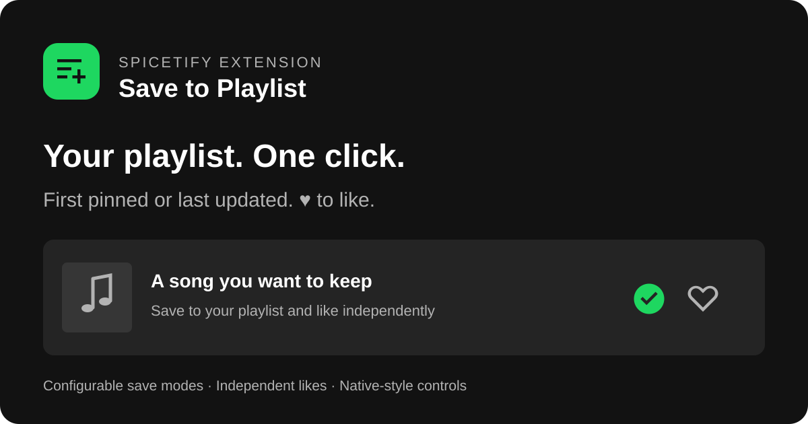

# Save to Playlist

A standalone Spicetify extension that replaces song-saving **+** controls with one-click saving to your first pinned or most recently updated playlist. A separate **♥** toggles Liked Songs.



## Marketplace

Search for **Save to Playlist** in Spicetify Marketplace after its index refreshes. This repository includes the required manifest, preview and compiled extension, and uses the `spicetify-extensions` topic for discovery. There is no separate extension submission PR. See the [official publishing requirements](https://github.com/spicetify/marketplace/wiki/Publishing-to-Marketplace).

If you previously installed manually, disable that copy before installing from Marketplace to avoid loading two copies. On Windows, use `./install.ps1 -Uninstall`, then install the Marketplace version.

If you installed before the compiled bundle moved to `dist/`, remove the old entry from **Marketplace → Installed**, then install it again from **Extensions** and reload Spotify. Marketplace keeps the script URL from installation; opening Installed alone does not refresh a changed file path. The settings dialog displays the running version so you can confirm an update.

## Versions and updates

Open **Save to Playlist settings** to see the running version. Click **Check for updates**, then **Install vX.Y.Z**, then **Reload Spotify**. Checking is manual; no background requests are made. The updater selects stable GitHub releases, validates the tagged bundle and updates only this extension's Marketplace record. It also migrates the old root script path. Settings are preserved. If a download fails, the existing installation is kept.

Fresh Marketplace installs use the release tag specified by the manifest. Use the settings updater for subsequent release updates. Marketplace's Installed tab checks repository activity but can retain its stored file path; it does not compare semantic versions. Tagged URLs avoid cached copies of the mutable main branch. The dist path stays stable in future releases. If Marketplace shows an older card after a release, restart Spotify to clear its session manifest cache before reinstalling.

For a manual installation, run `./install.ps1 -Update` from the project folder or an extracted release ZIP. It downloads the latest stable release, verifies its SHA-256 checksum, and reapplies Spicetify. Avoid enabling a manual copy alongside the Marketplace copy.

See [release notes](https://github.com/lucas98sf/spotify-plugin-save-to-playlist/releases) and [CHANGELOG.md](CHANGELOG.md).

### Forcing an older Marketplace installation to update

If settings already shows a version, use **Check for updates → Install → Reload Spotify**. No cache deletion is needed.

For older copies without an update control, remove this extension from **Marketplace → Installed**, fully quit Spotify (including its tray process), reopen it, and install from **Extensions** again. Quitting clears Marketplace's session manifest cache. Confirm the running version in the extension's settings afterward.

Deleting Spotify's music cache does not purge jsDelivr's server cache. New installations now use a release tag to avoid that stale main-branch URL. If Marketplace still serves an old card, wait for the remote manifest cache to refresh. For an immediate alternative, remove the Marketplace copy, download the latest release ZIP, extract it, and run `./install.ps1`; that installs the version from the ZIP manually. Do not keep both copies enabled.

## Install on Windows

With Spicetify already installed, run from this folder:

```powershell
./install.ps1
```

This copies the extension into the configured Spicetify Extensions directory, enables it alongside existing extensions, and runs `spicetify apply` (which can restart Spotify). No developer account, API key, or build step is needed.

Open Spotify's profile menu → **Save to Playlist settings**.

- **Enable:** turning it off restores Spotify's original buttons immediately.
- **Save mode:** save to the selected playlist (default), or playlist AND Liked Songs. Disable the extension for Spotify's default behavior.
- **Destination:** first pinned playlist (default), or most recently updated editable playlist in Your Library, including unpinned playlists and playlists in folders. Reorder your pins to change the first-pinned destination. In recent mode, editing a different playlist changes the destination; listening alone does not. Settings display the selected playlist's name automatically.
- **Separate ♥ button:** show an independent ♥ for Liked Songs alongside + (default on). Liked Songs always uses ♥.

Click **+** to add a song to the selected playlist; click its check again to remove it. ♥ toggles Liked Songs independently. In both mode, **+** adds the song to both destinations, and clicking the check removes it from the playlist while keeping it in Liked Songs. The destination is resolved before each save. If there is no pinned playlist or the first pin is not editable, first-pinned mode shows an error. Recent mode skips playlists without confirmed editing permission and reports an error if modification order cannot be determined reliably. Partial success is reported if one destination works and the other fails.

The playlist button shows a green check when the song is already in the selected playlist. On other Spotify pages, clicking that check removes the song from the playlist. On the destination playlist's own page, song rows hide the redundant playlist button; use Spotify's track menu there to remove a song. ♥ tracks Liked Songs separately. Status refreshes after saves, playlist edits, pin changes, navigation, and periodically for changes from other devices. Player and queue controls remain available.

Both buttons share a compact group and use Spicetify tooltips styled to match Spotify's native tooltip font, background, spacing, rounded corners and shadow.

Settings are saved per Spotify account. The extension supports song-save controls in the player and track rows whose song URI can be identified. Album, artist, podcast, playlist-follow controls and context menus retain Spotify's behavior. It does not intercept keyboard shortcuts.

## Compatibility

Developed against installed Spicetify 2.45.3 / Spotify 1.3.4.258. Uses Spicetify's `LibraryAPI`, `PlaylistAPI`, profile menu and popup modal. Supports Spotify's generic Encore curation controls as well as older Spicetify button classes. These internal APIs and Spotify's DOM can change; after a Spotify update, update/reapply Spicetify. If controls are missing or a target cannot be resolved, use the off switch and report your versions.

Recent mode requests Spotify's Recently Updated order with flattened playlists and `ignorePinning: true`. An isolated library API receiver adds that internal option without changing Spotify's own library sorting. This includes empty playlists and avoids mistaking playback or pin order for editing. An unsupported API or incomplete response produces a clear error rather than selecting another destination.

Previously called **Pinned Playlist Plus**. The script filename, account settings key, legacy runtime alias, and generated bundle header retain their original identifiers for compatibility with existing Marketplace installations and v1.1.5 updaters. The visible name is **Save to Playlist**; no reinstall or settings reset is required.

API reference: [Spicetify Platform](https://spicetify.app/docs/development/api-wrapper/methods/platform), [extension installation](https://spicetify.app/docs/customization/extensions).

## Development

Requires Node.js 24 or newer. TypeScript in `src/` is the source of truth. The generated standalone JavaScript bundle lives in `dist/` for Marketplace and manual installation; it is checked in so users can install without Node.js or a build step. The repository root contains no generated JavaScript file.

```powershell
npm ci
npm run check
npm test
npm run build
```

`npm run check` runs strict type checking, formatting checks, and compilation. Use `npm run format` to format changes. After editing source, rebuild and commit the generated bundle in `dist/` with it. CI checks Windows and Linux and rejects a bundle that differs from its source.

| Module                              | Responsibility                                              |
| ----------------------------------- | ----------------------------------------------------------- |
| `src/index.ts`                      | Wait for Spicetify and start once                           |
| `src/types.ts`                      | Typed boundary for the Spotify and Spicetify APIs used here |
| `src/settings.ts`                   | Validate persisted settings                                 |
| `src/actions.ts`                    | Resolve the selected playlist, save songs and toggle likes  |
| `src/dom.ts`                        | Identify native save buttons and their track URIs           |
| `src/runtime.ts`                    | Manage controls, membership caches, events and cleanup      |
| `src/settings-view.ts`              | Settings dialog and native save button                      |
| `src/constants.ts`, `src/styles.ts` | Icons, defaults and visual styles                           |

The internal API types describe the observed client surface. Spotify's private React-fiber access is isolated in `dom.ts`; no broad `any` types or suppressed type errors are used. Tests load a separate CommonJS build of the same source modules, without starting the browser extension.

Tests cover target selection, duplicates, destination failures, independent likes, track selection, DOM replacement, recycled rows, playlist membership, hiding destination rows, edit/pin events, stale responses, tooltip lifecycle and restoring the native UI. They use mocked Spotify APIs and jsdom; they do not save songs to a real account.

The controls were also verified in the running Spotify client: both buttons render, the native save control is hidden, tooltips match native styling, clicks route to the correct API, an existing song shows the playlist check, and destination rows hide their playlist action. Account write methods were stubbed during click verification.

## Releasing

Versions follow **major.minor.patch**: breaking changes, compatible features, and fixes. `package.json` is the source of truth; npm's version hook synchronizes `manifest.json` and rebuilds the bundle. Never move an existing release tag or change the bundle path.

From a clean main branch, update `CHANGELOG.md`, commit it, then run:

```powershell
npm version patch  # or minor / major
git push origin main --follow-tags
```

The tag workflow validates the tag against package.json and manifest.json, runs checks and tests, verifies the committed bundle, and publishes a GitHub release with the extension, Windows ZIP and SHA256SUMS. A failed workflow does not publish a release. The manifest on main selects that release tag for Marketplace installations; the settings updater installs subsequent tagged stable releases. After release, verify the running version in settings.

## Uninstall

```powershell
./install.ps1 -Uninstall
```

This disables this extension and reapplies Spicetify. It preserves settings and the extension file so reinstalling is easy.

## License

MIT. This project is independent of Spotify and Spicetify.
